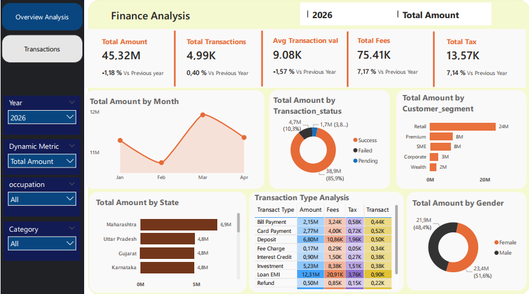
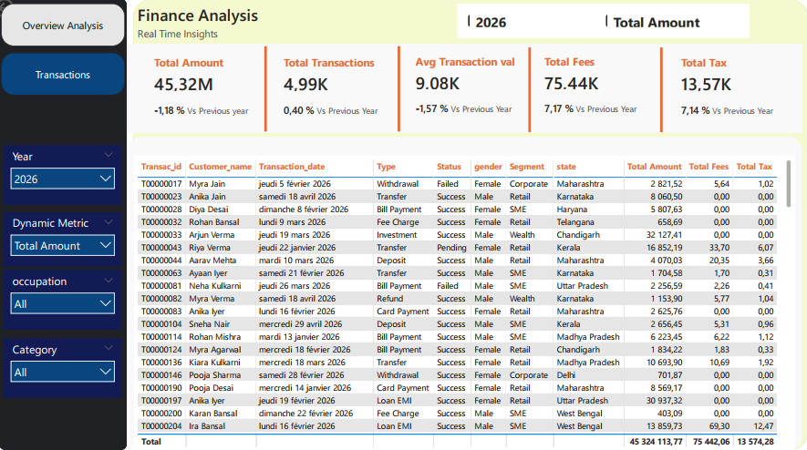

# Analyse Financière des Transactions — Tableau de Bord Power BI

### Montants, transactions, frais, taxes, profils clients et comparaison avec l'année précédente

**Auteur :** Brice Abogo  
**Spécialisation :** Analyse financière | Comptabilité | Business Intelligence  
**Technologies :** Power Query | DAX | Power BI Desktop | Power BI Service | Passerelle de données locale



---

## 1. Présentation du projet

Ce projet présente une solution de Business Intelligence de bout en bout pour le suivi de transactions financières. Deux fichiers CSV (transactions et clients) sont transformés avec Power Query, organisés dans un modèle en étoile, puis exploités par des mesures DAX dans un rapport Power BI de deux pages.

Le rapport permet de :

- suivre le volume, le nombre, le montant moyen, les frais et les taxes des transactions ;
- comparer chaque indicateur avec la même période de l'année précédente ;
- analyser les transactions par mois, statut, type d'opération, segment de clientèle, état et genre ;
- choisir dynamiquement la mesure affichée grâce à un paramètre de champs ;
- consulter le détail des transactions au niveau de chaque opération.

Le projet illustre aussi la publication sur Power BI Service avec une passerelle de données locale et une actualisation planifiée.

---

## 2. Questions analysées

1. Comment évoluent le volume, le nombre et le montant moyen des transactions par rapport à l'année précédente ?
2. Comment évoluent les frais et les taxes prélevés ?
3. Quelle part du volume est réalisée avec succès, en échec ou en attente ?
4. Quels segments de clientèle, quels états et quels types d'opérations pèsent le plus ?

---

## 3. Outils et technologies

| Technologie | Usage |
|---|---|
| Power Query (M) | Import, nettoyage, dédoublonnage et typage des données |
| Power BI Desktop | Modèle de données et rapport interactif |
| DAX | Mesures, comparaisons N-1, paramètre de mesures dynamiques |
| Power BI Service | Publication du rapport |
| Passerelle de données locale (mode standard) | Accès aux fichiers CSV locaux et actualisation planifiée |
| GitHub | Documentation et portfolio |

---

## 4. Données

| Fichier | Contenu | Colonnes |
|---|---|---:|
| `data/finance_transactions.csv` | Transactions financières | 15 |
| `data/customers.csv` | Référentiel clients | 11 |

- **Période :** du 1ᵉʳ janvier 2023 au 30 avril 2026.
- **Volume :** 50 000 transactions après dédoublonnage.
- **Origine :** source publique en ligne, non identifiée avec certitude. Licence d'origine non confirmée.
- **Usage :** pédagogique et démonstratif. Les données sont vraisemblablement fictives.

> La licence MIT s'applique au code et à la documentation, **pas aux fichiers de données**. Détails dans [`data/README.md`](data/README.md).

---

## 5. Préparation des données

Les scripts Power Query, commentés et documentés, sont dans [`power-query/`](power-query/).

| Traitement | Détail |
|---|---|
| Dédoublonnage | 69 identifiants en double ; la ligne la plus complète est conservée |
| Typage | Dates lues au format explicite `JJ-MM-AAAA`, nombres avec le point décimal : aucune dépendance aux paramètres régionaux du poste |
| Nettoyage | Espaces superflus supprimés, devise en majuscules |
| Frais manquants | 23 cas, **non imputés** ; repérés par la colonne `is_fee_missing` |
| Montants négatifs | 8 cas, traités comme anomalie probable ; les mesures reposent sur `amount_abs` |
| Nom complet client | Fusion de `fisrt_name` et `second_name` dans `Customer_name` |

---

## 6. Modèle de données

Schéma en étoile : une table de faits et deux dimensions. La table `Dynamic Metric` est autonome.


| Relation | Colonnes |
|---|---|
| `Calendar Table` → `finance_transactions` | `Date` → `transaction_date` |
| `customers` → `finance_transactions` | `customer_id` → `customer_id` |

Détails dans [`documentation/modele-de-donnees.md`](documentation/modele-de-donnees.md).

---

## 7. Mesures DAX

| Famille | Mesures |
|---|---|
| Mesures de base | Total Amount, Total Fees, Total Tax, Total Transactions, Avg Transaction val |
| Année précédente | PY Amount, PY Total Fees, PY Total Tax, PY Transaction, PY Avg Transaction |
| Variations annuelles | YoY % Amount, YoY % Total Fees, YoY % Total Tax, YoY % Transaction, YoY % Avg Transaction value |
| Contrôle qualité | Nb Frais Manquants, Nb Montants Négatifs |
| Affichage | Selected Year, Selected Dynamic Metric |

Points de conception :

- les variations renvoient une **valeur vide**, et non un faux « 0 % », lorsque l'année précédente est absente ;
- la table calendrier s'arrête à la dernière transaction : en 2026, janvier à avril sont comparés à janvier à avril 2025 ;
- un paramètre de champs permet de basculer entre quatre mesures.

Documentation complète dans [`dax/`](dax/).

---

## 8. Pages du rapport

### Page 1 — Overview Analysis

Cinq indicateurs avec variation annuelle, évolution mensuelle, répartition par statut, par segment, par état, par genre et analyse par type d'opération.


### Page 2 — Transactions

Les mêmes indicateurs et le détail ligne par ligne : identifiant, client, date, type, statut, genre, segment, état, montant, frais et taxes.



**Filtres :** Year, Dynamic Metric, occupation et Category.

---

## 9. Indicateurs clés

### Année 2026 (1ᵉʳ janvier au 30 avril), comparée à la même période de 2025

| Indicateur | Valeur | Variation N-1 |
|---|---:|---:|
| Total Amount | 45 324 113,77 (45,32M) | −1,18 % |
| Total Transactions | 4,99K | +0,40 % |
| Avg Transaction val | 9,08K | −1,57 % |
| Total Fees | 75 413,00 (75,41K) | +7,17 % |
| Total Tax | 13 574,28 (13,57K) | +7,14 % |

### Toutes années (2023 à avril 2026)

| Indicateur | Valeur |
|---|---:|
| Transactions | 50 000 |
| Total Amount | 455 534 249,62 |
| Montant moyen | 9 110,68 |
| Total Fees | 725 914,91 |
| Total Tax | 130 736,35 |

*Montants exprimés dans la devise du jeu de données (`INR` dans les lignes examinées).*

---

## 10. Constats (2026, janvier à avril)

1. **Volume stable, montant moyen en baisse.** Le volume recule de 1,18 % pour un nombre de transactions en hausse de 0,40 %, d'où un montant moyen en baisse de 1,57 %.
2. **Frais et taxes progressent plus vite que le volume.** Les frais augmentent de 7,17 % et les taxes de 7,14 %, alors que le volume diminue. Les frais représentent environ 0,17 % du volume. Les taxes suivent les frais, car elles en représentent 18 %.
3. **Une transaction sur dix est en échec.** 85,9 % du volume est en statut *Success*, 10,3 % (4,7M) en *Failed* et 3,8 % (1,7M) en *Pending*.
4. **Le segment Retail domine.** Il représente 24M, soit environ 53 % du volume. Premium et SME pèsent 8M chacun, Corporate 3M et Wealth 2M.
5. **Répartition géographique et par genre.** Maharashtra est l'état au volume le plus élevé (6,9M). Les femmes représentent 51,6 % du volume et les hommes 48,4 %.

> `Total Amount` cumule tous les statuts de transaction, y compris les échecs et les opérations en attente.

### Pistes d'approfondissement

- analyser les échecs par canal et par type d'opération ;
- exploiter les colonnes `is_fraud` et `risk_score`, chargées mais non utilisées dans les pages actuelles ;
- comparer les frais par type d'opération pour expliquer leur progression.

---

## 11. Architecture technique

```text
Fichiers CSV locaux
        |
        v
Power Query (import, nettoyage, dédoublonnage, typage)
        |
        v
Modèle en étoile (faits, clients, calendrier)
        |
        v
Mesures DAX (base, N-1, variations, paramètre dynamique)
        |
        v
Rapport Power BI Desktop (2 pages)
        |
        v
Power BI Service
        |
        v
Passerelle de données locale (mode standard)
        |
        v
Actualisation planifiée : 11 h 30 et 17 h 00 (heure d'Afrique du Sud)
```

Guides : [publication](documentation/guide-publication-power-bi-service.md) et [passerelle et actualisation](documentation/guide-passerelle-et-actualisation.md).

---

## 12. Utiliser le projet

1. Téléchargez le dépôt (**Code**, puis **Download ZIP**).
2. Placez les deux CSV dans `C:\Data\analyse-financiere\`, ou adaptez les paramètres `PathFinance` et `PathCustomers`.
3. Ouvrez `power-bi/analyse-financiere-transactions.pbix` dans Power BI Desktop.
4. Vérifiez les valeurs de contrôle du [guide d'installation](documentation/guide-installation.md).

**Consulter sans Power BI :** [rapport PDF](rapports/analyse-financiere-power-bi.pdf) et [captures](images/).

> L'accès interactif sur Power BI Service n'est pas disponible publiquement (restriction du compte utilisé).

---

## 13. Limites

- Source de données non identifiée, licence d'origine non confirmée.
- L'année 2026 s'arrête au 30 avril ; les variations comparent des périodes équivalentes.
- Les variations sont vides pour 2023 (pas d'année précédente) et lorsque plusieurs années sont sélectionnées.
- L'actualisation est planifiée deux fois par jour : ce n'est pas du temps réel.

Liste complète : [`documentation/limites-et-avertissements.md`](documentation/limites-et-avertissements.md).

---

## 14. Structure du dépôt

```text
analyse-financiere-transactions-power-bi/
├── README.md
├── LICENSE
├── CHANGELOG.md
├── data/             # fichiers CSV sources
├── power-query/      # scripts M
├── dax/              # mesures, calendrier, paramètre dynamique
├── documentation/    # dictionnaire, modèle, guides, limites
├── images/           # captures du rapport et du modèle
├── rapports/         # export PDF
└── power-bi/         # fichier .pbix
```

---

## 15. Compétences démontrées

- **Analyse financière :** suivi des volumes, frais et taxes, comparaison N-1, analyse par segment.
- **Power Query :** nettoyage, dédoublonnage, typage indépendant de la région, traçabilité des anomalies.
- **Modélisation :** schéma en étoile, table calendrier, relations.
- **DAX :** mesures, intelligence temporelle, paramètre de champs.
- **Publication et exploitation :** Power BI Service, passerelle de données locale, actualisation planifiée.
- **Qualité et documentation :** contrôles de cohérence, hypothèses documentées, dépôt structuré.

---

## 16. À propos de l'auteur

### Brice Abogo

**Comptable | Analyste financier | Business Analyst**

Professionnel de la finance, de la comptabilité et de la Business Intelligence, avec plus de quinze années d'expérience en comptabilité générale, analytique et budgétaire, audit, reporting financier et visualisation de données.

**Compétences :** Power BI, Power Query, DAX, SQL, Excel, Python, Sage, analyse financière, contrôle de gestion.

- GitHub : [YvesBriceAbogo](https://github.com/YvesBriceAbogo)
- LinkedIn : [brice-abogo](https://www.linkedin.com/in/brice-abogo)

---

## 17. Licence et statut

- **Licence :** MIT pour le code et la documentation. Les données ne sont pas couvertes (voir [`data/README.md`](data/README.md)).
- **Statut :** Version `v1.0.0`. Historique dans [`CHANGELOG.md`](CHANGELOG.md).
