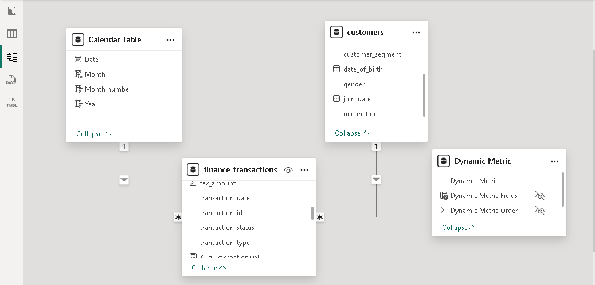
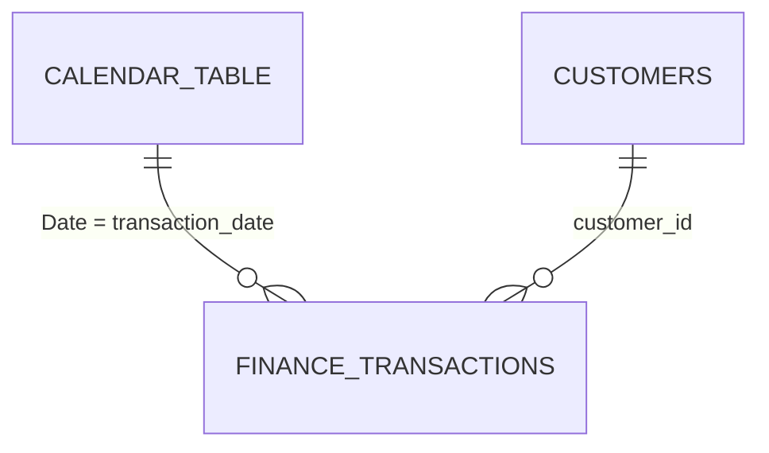

# Modèle de données

## Architecture

Le modèle est un **schéma en étoile** : une table de faits (`finance_transactions`) et deux dimensions (`customers` et `Calendar Table`). La table `Dynamic Metric` est autonome.

## Relations

| De (côté 1) | Vers (côté plusieurs) | Colonnes | Sens du filtre |
|---|---|---|---|
| `Calendar Table` | `finance_transactions` | `Date` → `transaction_date` | Unique : de la dimension vers les faits |
| `customers` | `finance_transactions` | `customer_id` → `customer_id` | Unique : de la dimension vers les faits |

## Conditions de validité

- `customers[customer_id]` doit être **unique** : le script Power Query supprime les doublons.
- `Calendar Table` couvre toutes les dates de transaction. Elle s'arrête volontairement à la dernière transaction, pour que les comparaisons avec l'année précédente portent sur des périodes équivalentes (voir `dax/table-calendrier.md`).
- `Dynamic Metric` n'a pas de relation : elle ne sert qu'à choisir la mesure affichée.

## Tables du modèle

| Table | Rôle | Documentation |
|---|---|---|
| `finance_transactions` | Faits et mesures | `dictionnaire-donnees.md`, `../dax/mesures-dax.md` |
| `customers` | Dimension clients | `dictionnaire-donnees.md` |
| `Calendar Table` | Dimension temps | `../dax/table-calendrier.md` |
| `Dynamic Metric` | Paramètre de champs | `../dax/parametre-mesures-dynamiques.md` |
